

 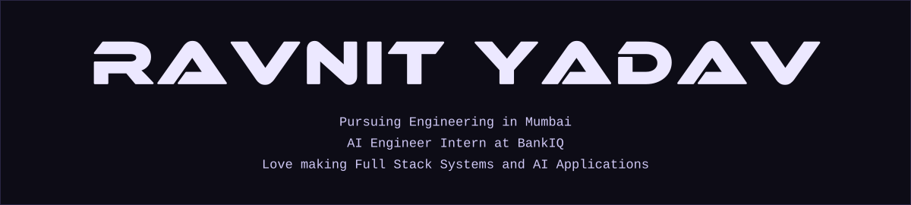
 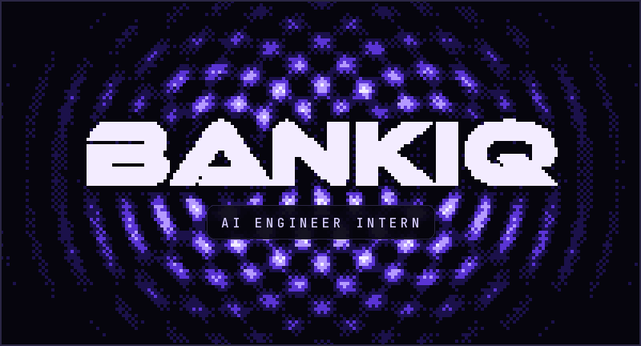<a href="https://github.com/yravnit/drag">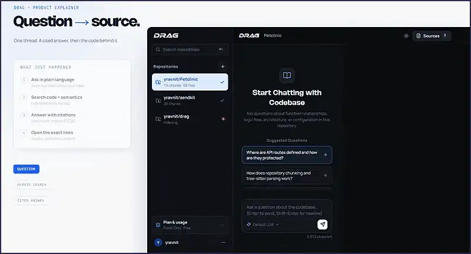</a>
 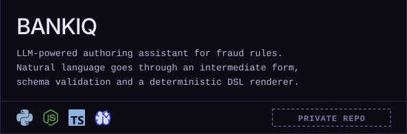<a href="https://github.com/yravnit/drag">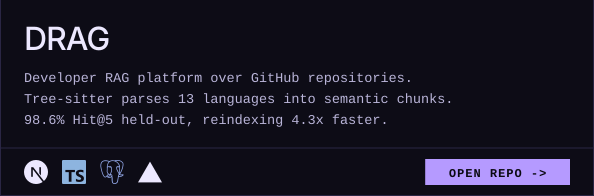</a>
 <a href="https://github.com/yravnit/PSH">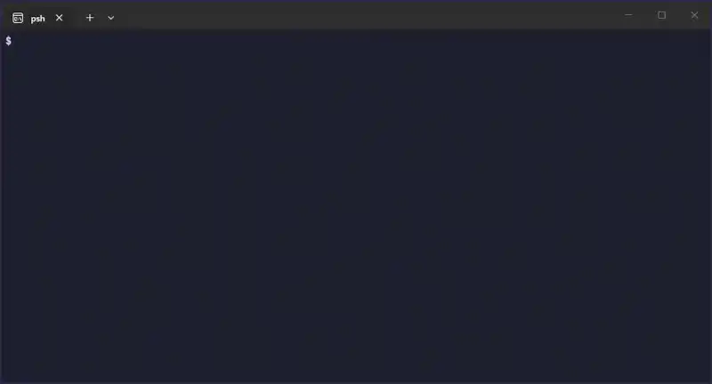</a><a href="https://github.com/yravnit/snag">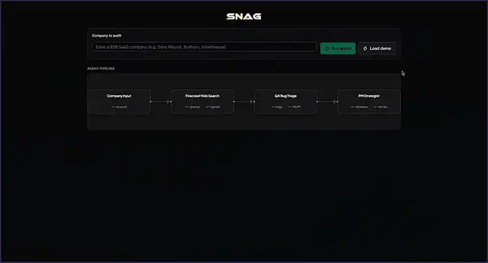</a>
 <a href="https://github.com/yravnit/PSH">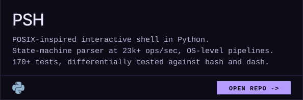</a><a href="https://github.com/yravnit/snag">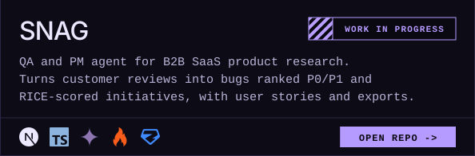</a>
 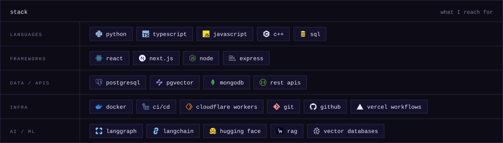
 <a href="https://github.com/yravnit/">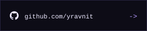</a><a href="https://www.linkedin.com/in/yravnit/">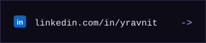</a><a href="https://leetcode.com/u/ravnit/">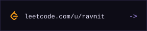</a><a href="mailto:yravnit@gmail.com">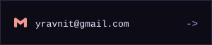</a>

